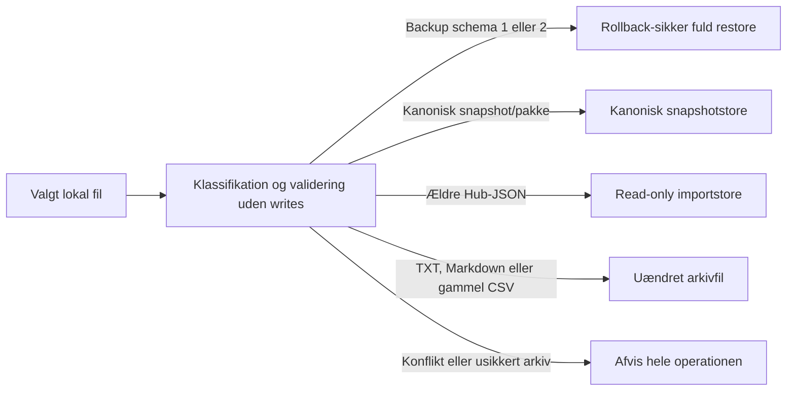

# Dataportabilitet og integritet

Hubben skelner mellem kanoniske data, afledte filer og ikke-gendannelige supportpakker. Almindelig opstart og navigation læser kun; eksport, backup, import, indeksreparation, arkivering og sletning kræver hver sin eksplicitte handling under **Data og lager**.

## Fælles datakontrakt

`DataPackage` schema 1 samler dokumenttype, scope, et tidszonebevidst ISO-8601-tidspunkt, provenance og en eller flere navngivne `DataTable`-tabeller. Rækker indeholder rå tekst-, heltals-, decimal-, boolske eller tomme værdier. Spiller-, hold-, manager-, sæson- og rapportprojektioner bruger denne kontrakt til maskinlæsbare formater.

| Format | Kontrakt |
| --- | --- |
| CSV | RFC 4180, CRLF og UTF-8 med BOM. En tabel giver én CSV; flere tabeller giver ZIP med `manifest.json`. |
| XLSX | `xlsxwriter`, ét ark pr. tabel. Formel-, URL- og talfortolkning af tekst er slået fra. |
| Parquet | Valgfri `holdet-lib[parquet]`-ekstraafhængighed med PyArrow. Flere tabeller giver ZIP. |
| TXT/JSON/Markdown | Eksisterende bytes, standardvalg og dokumentstruktur er bevaret. |

Tekst der kan starte en regnearksformel (`=`, `+`, `-`, `@`, tab eller carriage return) får en indledende apostrof i CSV/XLSX. JSON og Parquet bevarer den oprindelige tekst, og numeriske værdier forbliver numeriske.

En spiller- eller holdeksport med flere formater publicerer hver fil atomisk og returnerer først artefakterne, når alle valgte formater er gemt. Ved en fanget fejl fjernes de filer, som netop dette forsøg publicerede. Hele formatsættet har ingen fælles atomisk synlighedsgrænse for mappeovervågning eller processtop.

## Samlet JSON for managerspil eller konkurrence

Den samlede eksport er et selvstændigt JSON-dokument med `schema_version: 1`, UTF-8 og rå tal, boolske værdier og `null`. Den bygges udelukkende af de lokale data, der er indlæst ved eksporten; den starter ikke en hentning og påvirkes ikke af tabelfiltre eller paginering. Eksporten er en dataudtrækning og ikke en backup, der kan gendannes. Eksisterende spiller-, hold- og rapporteksporter beholder deres egne formater.

- `scope` angiver spillets identitet og navn, om udtrækket gælder hele spillet eller én konkurrence, samt om spillet er arkiveret og skrivebeskyttet. Spilscopet omfatter alle konkurrencer i spillet, deres unikke medlemmer og et eventuelt konfigureret eget hold. Konkurrencescopet omfatter kun den valgte konkurrence og dens deltagere. Begge scopes indeholder hele spillets tilgængelige spillerkatalog.
- `players.current` indeholder det fulde kanoniske spillersnapshot for den højeste lokalt tilgængelige runde, med den seneste korrektion for netop den runde. `players.quality` angiver manglende eller forældede kilder. Når spillerhistorik vælges, indeholder `players.history` det seneste korrigerede snapshot for hver lokal runde.
- `teams` indeholder ét element pr. hold med seneste tilgængelige overblik og opstilling, `quality` samt `summaries` for alle tilgængelige runder. Hvert rundesammendrag kommer fra den seneste kilde, der dækker runden, og har sit kildetidspunkt. Manglende hold bevares med et tomt snapshot.
- `competitions` indeholder definitioner, medlemmer og stillinger. Turneringer indeholder også revisioner, publicerede kampe, kampplan, resultater, status og eventuelle parringskonflikter. Både aktive og arkiverede revisioner indlæser deres egne gemte parringer og validerer dem mod revisionens deltagere. En ulæselig eller konfliktfyldt kampplan markeres med `quality: ["unverified"]` i den berørte definition og en advarsel i filen; øvrige data kan stadig downloades, og aktive uverificerede resultater giver ingen placeringer eller mester.
- `metadata` indeholder, når den findes, seneste spilinfo, regler, rundetider og hentetidspunkt. `refresh_manifest` indeholder et resumé af den seneste valgte opdateringskørsel og relevante deltrin, når et manifest er tilgængeligt. Manifestets samlede resultat beskriver hele den oprindelige kørsel, også hvis konkurrencens eksport viser et udsnit af holdtrinnene. `warnings` angiver antallet af advarsler fra de indlæste kilder; detaljerne ses i appen.

Kvalitetsmarkører inkluderer `missing`, `stale` (mindst 24 timer gammelt), `older_round`, `before_round_end`, `preliminary` og `unverified`. De beskriver det kendte lokale grundlag og garanterer ikke, at kilden ikke er ændret efter hentning. Lokale filstier, kontokonfiguration, noter og indstillinger indgår ikke; fejltekster og filreferencer fra opdateringsmanifestet udelades. Udtrækket kan indeholde hold-, ejer- og spilleridentiteter og er ikke en anonymiseret supportpakke.

## Rapporter og anonymisering

Managerspilrapporten indeholder dataproveniens, rundestatus, hold, grupper/turneringer, stillinger og rundehistorik. Sæsonrapporten indeholder konkurrencer, samlet managerstilling, pointsammensætning, medaljer og provenance. Rundens historie kan desuden eksporteres som forklarlig standalone HTML med validerede Holdet-links og valgfri, på forhånd byggede loopback-links; **Åbn i lokal Hub** virker kun, mens Hubben kører. HTML er autoritativ: én escaped fil med indlejret CSS, skærm- og A4-printlayout, ingen JavaScript og ingen eksterne assets. Brug browserens **Udskriv → Gem som PDF** for PDF. Se [Rundecenter og daglig arbejdsgang](round-center.md) for fakta- og linkkontrakten.

En forberedt rapport er et mærket øjebliksbillede med eget tidspunkt. Senere dataændringer kræver en ny eksplicit forberedelse. Gemte rapportlinks og supportpakker bindes til pakkens indhold, identitet, titel og filnavn; et ændret grundlag skjuler tidligere downloads i den aktuelle handling. Skift mellem anonymiseringsprofiler kræver en ny supportpakke. Allerede gemte eksportfiler ændres ikke.

Supportpakker har `support-manifest.json`, SHA-256 for indholdet, `restorable: false` og ingen pseudonymmapping:

- `share` erstatter konto-, manager-, fantasyhold- og brugeridentiteter med stabile pseudonymer inden for pakken. Offentlige sportsmålinger bevares.
- `debug` minimerer yderligere og fjerner lokale stier, URL'er, noter, tags, fritekst og genkendelige labels.

## Importregler

Identiske SHA-256-værdier springes over. En identitetskollision med andet indhold afviser operationen før første write. Ældre JSON blandes aldrig ind i analyser, og tekst/Markdown/CSV parses ikke til domænedata. En anonymiseret supportpakke kan arkiveres, men aldrig gendannes.

Forskellige gyldige observationer, som får samme tidsbaserede filnavn, tildeles numeriske suffikser. Preview reserverer alle planlagte mål og søger også efter identiske eksisterende suffiksfiler, når basisfilen er fjernet. Ikke-backupimport genberegner planen under datalåsen og beholder låsen gennem publicering eller tilbagerulning. En ændret placering kan give et andet genereret suffiks; de godkendte kildebytes bevares, og eksisterende indhold overskrives ikke.

ZIP-validering afviser traversal, backslashes, absolutte stier, dubletter, mapper, symlinks, for mange medlemmer, for store enkeltfiler eller totaler, for stort manifest og mistænkelig kompressionsratio.

## Integritetsindeks

`data/integrity-index.json` schema 1 er afledt og aldrig sandhedskilden. Hver post har relativ sti, type, spilscope, størrelse, `mtime_ns`, kendt schema-version og SHA-256.

- Hurtig kontrol sammenligner eksistens, størrelse, ændringstid og kendte JSON-schemas.
- Fuld kontrol streamer SHA-256 og parser alle kanoniske JSON-filer.
- **Reparer indeks** viser tilføjede, ændrede og fjernede poster og erstatter kun indeksfilen atomisk. Korrupte data ændres eller skjules ikke.

Den afsluttende previewkontrol og publicering sker under data- og konfigurationslåsene. Et ændret grundlag afviser reparationen; almindelige kontroller og previews tager ingen skrivelås.

## Lager, retention og oprydning

Lagerinventaret viser eksakte bytes og filantal pr. managerspil samt **Fælles** for globale data. Kategorierne er aktive snapshots, manifester/revisioner, importerede data, afledte eksporter, backups og arkiver.

Retention vælger deterministisk kun ældre, gyldige versioner:

- nyeste spillersnapshot bevares pr. `(locale, spil, runde)`;
- nyeste teamsnapshot bevares pr. `(locale, spil, hold, runde)`;
- korrupte eller uklassificerbare filer vælges aldrig automatisk.

Arkivering skriver de oprindelige relative stier og checksums til en midlertidig ZIP, validerer hele arkivet og publicerer det atomisk. Først derefter forsøges kilderne fjernet. Manuel sletning er begrænset til valgte afledte eksporter, rapporter, gamle backups og eksisterende mellemversionsarkiver; den nyeste backup, konfiguration, revisioner, manifester og aktive snapshots er ikke tilladte mål.

## Sportsadaptere

Det interne registry har indbyggede `SportAdapter`-objekter for fodbold, amerikansk fodbold (`nfl`), cykling, Formel 1 og golf. Adaptere ejer rute-/formatmapping, labels, positionsnormalisering, præsentation og sportskapabiliteter. `GameRuleProfile` er fortsat den sæsonspecifikke regelautoritet. Adapterdefaults er altid `unverified`, og format- eller slugmatches kan ikke give en grøn regelgodkendelse.

Der indlæses ingen tredjeparts-entry-points eller dynamisk Python-kode. De eksisterende top-level-konstanter og hjælpefunktioner er kompatibilitetsfacader.
