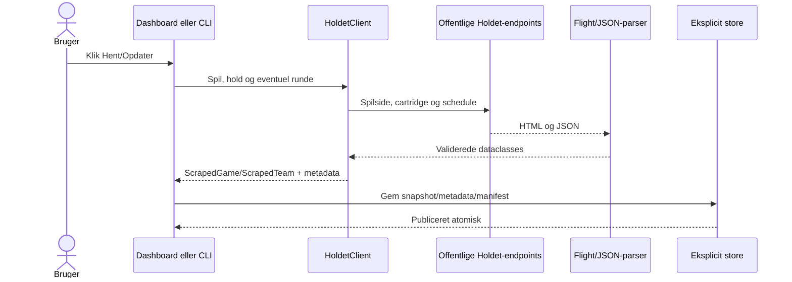

# Datahentning fra Holdet.dk

Biblioteket henter offentligt server-renderet HTML og JSON fra Holdet.dk. Det bruger ikke login, cookies, Selenium, browser-scrolling eller skjulte browserprofiler.

## Fra klik til cache



Navigation, `/scouting`, Rundecenter, Managers, H2H, sæsoner, Kalender, Datastatus, Analyse, spillerdetaljer, alarmfaner, smartlister, notesøgning, sammenligning, intra-runde-ændringer og Transferlaboratorium stopper før første netværkspil. De bruger kun eksisterende snapshots, publicerede parringer, metadata, HubSettings og refresh-manifester. Manglende data vises som en datamangel og udløser aldrig automatisk kontakt til Holdet. Se [Rundecenter og daglig arbejdsgang](round-center.md).

## URL, variant og spilpolitik

En spiladresse normaliseres til locale og slug fra:

```text
https://www.holdet.dk/<locale>/fantasy/<slug>/...
```

En bar slug bruger locale `da`. Ukendte hosts og ugyldige stier afvises før en netværksanmodning. Den offentlige spilside hentes fra `https://www.holdet.dk/<locale>/season/<slug>`. `GameUrl.season_root_url` bygger adressen; `nexus_root_url` er et kompatibilitetsalias til samme adresse. JSON-data hentes fra `https://www.holdet.dk/api/fantasy`, herunder `/cartridges/<slug>` til spilmetadata. Den tidligere `/api/season`-adresse returnerer en HTML-side og må ikke bruges til JSON-hentninger.

Cartridge-data leverer ruleset og metadata. Biblioteket skelner mellem rå route-variant, normaliseret format (`soccer`, `cycling`, `formula1`, `golf`, `nfl`) og enhed (`money`, `points`). `salaryCap > 0` betyder penge; `salaryCap = 0` betyder point. Det er nødvendigt for cykling, hvor route-navnet alene ikke afgør enheden.

## Spillerstatistik

Statistiksiden hentes fra:

```text
/<locale>/season/<slug>/<route-variant>/statistics[?round=<runde>]
```

Next.js Flight-strenge samles fra scripts, og parseren finder den gyldige `rows`-liste og runde. Hele serverpayloaden bruges uanset den virtualiserede tabels synlige rækker. Et eksplicit spiller-refresh gemmer både det komplette spillersnapshot og de tilgængelige spilmetadata.

De obligatoriske identitets-, hold-, positions-, pris- og statusfelter valideres strengt. De offentlige felter `popularity`, `popularityChange`, `trend`, `index`, `stats` og `totalStats` er valgfrie. I preseason-payloads valideres de fire numeriske scoutingfelter pr. værdi: `null` mappes til `None`, og et endeligt tal mappes til den tilsvarende numeriske værdi. Korte, entydige statnavne og endelige statværdier bevares i snapshot schema 4. Ukendt form, ikke-endelige tal eller kildedrift ignoreres fail-closed for det valgfrie felt, så den almindelige spillerparser fortsat kan levere de obligatoriske data. Parser-canaryen overvåger felterne separat på de syv aktuelle spil, inklusive Premier League og Football Fantasy 2026 (`nfl`).

**Mellem runder** sammenligner det nyeste lokale snapshot i valgt og foregående tilgængelige runde. **Mellem hentninger** sammenligner de to seneste kronologiske snapshots uden at kollapse samme rundenummer. Begge er rene cacheberegninger.

Efter **Hent seneste** evalueres watchlistregler, når Statusalarmer er aktiveret i Indstillinger, mod den umiddelbart foregående hentning og, for prisdeltaets resettilstand, den foregående baseline. Pris-, procent- og Form 3/5-regler kræver en krydsning; første observation uden baseline alarmerer ikke. Statusreglen registrerer enhver overgang. Historisk backfill danner aldrig aktuelle alarmer.

## Fantasyhold, historik og schedule

En teamhentning kombinerer fantasyteam-siden, `/api/fantasy/fantasyteams/<id>/history`, offentlige ranglister og cartridge-data. `/api/fantasy/schedules/<schedule-id>` hentes sammen med manuelle spiller- og holdhentninger.

Spillets cartridge leverer `defaultFantasyLeagueId`, som bruges til at hente holdets officielle placeringer blandt alle hold i managerspillet:

```text
/api/fantasy/fantasyteams/<team-id>/fantasyleagues/<defaultFantasyLeagueId>/leaderboards/overall
/api/fantasy/fantasyteams/<team-id>/fantasyleagues/<defaultFantasyLeagueId>/leaderboards/round
```

Begge svar indeholder en `items`-liste med `round` og `rank`. Importen matcher på rundenummer og gemmer `overall` som `RoundSummary.overall_rank` og `round` som `RoundSummary.round_rank`. Samlet placering gælder holdets total i den pågældende runde; rundeplacering gælder kun rundens vækst. Grupperang beregnes separat ud fra den lokale gruppes medlemmer.

Ranglisterne leverer også historiske runder, så én manuel holdopdatering kan hente tidligere placeringer. Hvis spillet mangler `defaultFantasyLeagueId`, eller en rangliste mangler en rundes placering, gemmes den som `None`. UI'et viser **–**, og historikgrafen har et hul. Placeringer estimeres aldrig fra gruppens resultater. Et fejlet ranglistekald følger den almindelige fejlhåndtering og cachefallback.

En igangværende rundes placeringer kan ændre sig. Visningerne bruger de senest gemte oplysninger for den valgte runde og kontakter ikke Holdet.dk ved navigation. Begge placeringsfelter findes allerede i teamsnapshot schema 2, holdeksporterne og det lokale `team_history`-API.

Schedule-parseren gemmer hver rundes `start`, `close` og `end`. Sluttid og hentetid afgør, om en sammenligning eller transfersimulation kan kaldes `final`, mens snapshotstatus er `complete`, `in_progress` eller `unknown`. Hvis schedulekaldet fejler, gemmes øvrige gyldige data med `unknown` og UI'et markerer grundlaget som foreløbigt.

For pengebaserede spil kontrolleres opstillingens værdi mod historikkens total minus bank. Uoverensstemmelse genhentes én gang og giver derefter fejl.

## Manuelle opdateringer og eventrevisioner

Kun eksplicitte manager-, spiller-, hold-, gruppe- og turneringshandlinger skriver nye snapshots eller metadata. **Opdater alle** starter én baggrundskørsel for alle aktive managerspil; **Opdater data** bruger samme indhentning for ét spil eller én konkurrence. En spilopdatering omfatter gruppernes unikke hold og et eventuelt eget hold valgt under spillets **Flere funktioner → Indstillinger**. Konkurrenceopdatering omfatter kun dens deltagere. Gyldig kompatibel cache kan genbruges efter en kildefejl.

Indhentningen genvurderer metadata og seneste spillerdata, udfylder manglende historiske spillerunder og genhenter afsluttede runder med foreløbigt eller uverificeret grundlag. Et retry bevarer den oprindeligt ønskede runde og afviser svar fra en anden runde. Fremdrift, delresultater og ventende manifester journalføres, så browseren kan genindlæses, og en afbrudt kørsel kan genoptages eksplicit. Én proceslås forhindrer overlappende opdateringer og samtidige restore-, import- eller retentionmutationer. Se [Rundecenter](round-center.md) for stop og genoptagelse.

Det udvidede Rundecenter har fortsat et bekræftet `RefreshPlan`-preview med alt, kun manglende/forældede data eller kun retrybare fejl fra et tidligere manifest. En komplet slutrunde-refresh, arkivering eller **Genopbyg historik fra cache** kan desuden publicere manager-events.

Et komplet resultat er append-only. Hvis kildedata rettes, gemmes en højere eventrevision med reference til den supersedede revision; den gamle payload overskrives ikke. Schema-1 Hall of Fame-events læses som legacy-revisioner og remappes gennem de aktuelle managerprofiler.

Almindelig navigation beregner kun Elo, awards, historier, H2H, sæsonstillinger og kalender-events som previews. Ufuldstændige runder markeres foreløbige og fryses ikke. Swiss-parringer publiceres først efter en eksplicit refresh, som har gjort den foregående runde komplet. Publicerede knockoutdeltagere fryses også pr. turneringsrevision; senere datakorrektioner ændrer scorer, men kan give en konflikt, som kræver en ny revision frem for stiltiende at udskifte deltagere.

## HTTP, retries og proxy

`HttpClient` bruger user-agent, afgrænset timeout og kontrollerede retries:

- transiente HTTP-statusser, timeouts og netværksfejl får op til tre samlede forsøg;
- aktivt afviste forbindelser får op til fem med eksponentiel ventetid;
- permanente 4xx-fejl og inkompatible payloads genforsøges ikke unødigt;
- Windows- og miljøproxyer respekteres;
- proxy-credentials skjules i tekniske fejl.

Ved fejl bevarer dashboardet en gyldig cache og tilbyder et eksplicit retry. Navigation starter aldrig automatiske genforsøg.

## Fejlprincipper og begrænsninger

Nødvendige felter valideres strengt. Tom spillerliste, manglende runde, ukendt format eller uforenelig historik giver en konkret fejl uden delvist snapshot. Valgfrie offentlige scoutingfelter kan være `None`; UI og det lokale API viser manglen og substituerer aldrig nul.

Der findes ingen automatisk netværkspolling eller scheduler. En eksplicit startet worker kan fortsætte, mens browseren navigerer; UI’et poller kun den lokale kørselsjournal. Kalenderen er cache-only og opretter ikke ICS-filer eller påmindelser. Historiske opstillinger vises kun, hvis et kanonisk teamsnapshot blev gemt præcis i runden. Manglende værdier, top-procenter eller resultater estimeres aldrig.

**Download JSON** opretter én samlet fil fra lokal cache med hele spillerkataloget, scopets hold, historik, konkurrencer og kildeoplysninger. Download udløser ingen Holdet-kald. **Opdater før download** starter indhentningen; efter afslutning vises downloadknappen direkte ved kørselsresultatet. Se [Dataportabilitet](data-portability.md).

## Fixturekilder og sæsonregler

Fixturedata må kun caches efter en eksplicit handling gennem en adapter, der er dokumenteret offentlig uden login og dækket af en parserfixture. En officiel difficulty vises uændret, hvis feltet og dets dokumentation er registreret; ellers vises ingen beregnet difficulty.

Spilmetadata valideres først mod det offentlige schema. Derefter slås den præcise locale/spil-/sæsonidentitet op i det auditerede regelregister. Et generisk formatmatch aktiverer aldrig rente, gebyr, kaptajn, formation eller idealhold. Se [Analyse- og beslutningscenter](decision-analysis.md).
