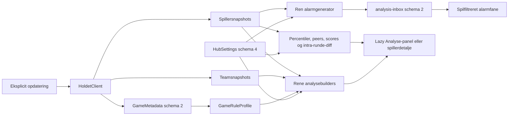

# Analyse- og beslutningscenter

Analysecenteret er en cachebaseret, retrospektiv beslutningsstøtte. Det findes som den ottende managerspilsfane **Analyse** og har panelerne **Beslutninger**, **Gruppe**, **Idealhold** og **Eksperimentel**. Kun det valgte panel beregnes. Navigation læser lokale snapshots og stores; netværk og persistente writes kræver fortsat et eksplicit opdaterings-, gemme- eller alarmklik.

Resultater er mærket med:

- `final`: alle nødvendige snapshots er afsluttede, og eventuelle sæsonregler er verificeret;
- `preliminary`: beregningen er mulig, men en runde eller modelvalidering er foreløbig;
- `unverified`: nødvendige regler, snapshots eller felter mangler.

Provenance indeholder anvendte runder, stikprøvestørrelse, manglende input og kildetype. Et generisk formatmatch er aldrig tilstrækkelig sæsonevidens.

## Formelkontrakt

| Analyse | Formel og gate |
| --- | --- |
| Historisk vækst pr. aktuel mio. | `total_growth / (value / 1_000_000)`. Kun pengespil; pris `<= 0` eller manglende vækst giver ingen værdi. |
| Form 3/5 | Middel af de seneste præcis 3 eller 5 afsluttede observationer. Et ufuldstændigt vindue giver ingen værdi. Rundehuller interpoleres ikke. |
| Stabilitet | På seneste højst fem afsluttede observationer og mindst tre: `sample_stdev(x)`, `scale=max(mean(abs(x)),1)`, `round(100/(1+dispersion/scale))`. 70–100 er stabil, 40–69 balanceret og under 40 boom/bust. |
| Kaptajn | Faktisk bonus er `RoundSummary.captain_bonus`. Et alternativ summerer `round_change * (multiplier - 1)` for det verificerede kaptajnantal; profiler med positiv bonus bruger først `max(0, round_change)`. Scenarier kræver præcis rundetrup og deaktiveres ved mismatch mod den officielle bonus. |
| Bank | Den tabte rente er `interest(A)-interest(A-P-fee(P))` for bank `A` og investering `P`. Break-even er gebyr plus tabt rente. Andelen af spillere over grænsen bruger form 3/5 frem til og med den valgte runde. |
| Transfer | For sammenhængende afsluttede snapshots: `decision_delta=bought_growth-fee-sold_next_growth`; `no_trade=actual_change-decision_delta`. Sæsonsummen er kun summen af et-rundes kontrafaktiske beslutninger. |
| Bedst/værst | Maksimum og minimum af verificerede transferdeltaer. Lighed afgøres af tidligste runde. Kaptajn og bank vises separat. |
| Gruppe/swing | Fælles og unikke spillere sammenlignes med gruppeføreren fra den valgte rundes stilling. Faktisk swing er endeligt, når begge holds rundedata og den anvendte spillervækst er afsluttet. Den formbaserede proxy bruger afsluttede observationer frem til og med den valgte runde. |
| Eksponering | `ejere / hold_med_dækkende_snapshot`. Dækkede hold, samlet gruppestørrelse og manglende hold vises altid. |
| Pris-/pointkurve | Bruger `PlayerHistoryPoint.value`-semantikken og faktiske rundenumre. Ikke-afsluttede punkter mærkes `preliminary`; en tom numerisk serie giver en forklaring i stedet for en graf. |

## Scoutingkontrakt

Scoutingbuilders er rene og eksporteres fra `holdet_lib`. `average_rank_percentiles` bruger gennemsnitsrang ved ties; `build_scouting_metrics` håndhæver positionskohorten og minimum fem numeriske peers; `build_peer_comparison`, `find_similar_players` og `build_smart_lists` genbruger det samme normaliserede positionsbegreb.

Potentiale 0–100 bruger Form 3-percentil 50 %, Form 5-percentil 20 % og værdieffektivitet 30 %. Form 3 samt én yderligere komponent kræves, og resterende vægte renormaliseres. Risiko 0–100 bruger 70 % omvendt stabilitetspercentil, 20 % statusrisiko og 10 % datarisiko. Statuskomponenten er maksimum af aktiv 0, inaktiv 60, skadet/karantæne 80 og deaktiveret 100. Datarisiko er 0 ved endeligt grundlag med mindst fem observationer, 40 ved 3–4, 70 ved foreløbige data og 100 ved utilstrækkeligt eller uverificeret grundlag.

Popularitet påvirker ikke potentiale eller risiko. ≤ 10 % er **differential**, ≥ 25 % er **template**. Ownership-risiko for en spiller uden for eget valgte hold er `popularitet_i_procent * potentiale / 100`; manglende popularitet, score eller trupgrundlag er **Ikke tilgængelig**.

`build_player_change_explanation` viser altid observerede deltaer. En `PerformanceRuleProfile` må kun opgradere præstationsfelter til kausale/additive bidrag, når profilen er verificeret, alle vægtede felter er numeriske, og summen afstemmer målændringen. Uden den afstemning kaldes felterne samtidige observationer.

`ComputedPlayerColumn` validerer en lukket AST-grammatik. Kun tal, kendte metrikker, regneoperatorer, sammenligninger, boolesk logik og de dokumenterede funktioner fortolkes. Attributter, subscripts, strenge, imports, comprehensions, lambdaer, potens, ukendte navne og referencesøjler afvises. Der findes ingen sti til `eval`, `compile` eller vilkårlig Python.

## Regel- og datakontrakter

`GameRuleProfile` er bundet til konkret locale og spil-/sæsonslug. En verificeret profil kræver en officiel kilde-URL og adgangsdato. Rente og transfergebyr gemmes som basispoint med en eksplicit `floor`, `ceil` eller `nearest`-afrunding. Budget, trupstørrelse, formation eller kategorier, klubgrænse, kontrakter og kaptajnregler er valgfrie, indtil de er dokumenteret.

Dashboardet og CLI'en bruger samme lokale regelgennemgang for spillet. En gennemgang forbliver verificeret, så længe den seneste komplette kilde stemmer med dens URL'er og fingeraftryk. `GameMetadata` schema 2 kan levere en kompatibel profil for samme spil, hvis der ikke findes en lokal gennemgang og kilden ikke modsiger profilen. Schema 1-metadata læses uden automatisk omskrivning. De generiske `TransferRuleProfile`-profiler er uverificerede.

Kaptajnanalysen bruger de samme positionsregler som transferberegningen. Den viser kun tilladte alternativer og markerer analysen som uverificeret, hvis de registrerede kaptajner mangler den krævede position.

Spillernoter og tags, watchlistregler og -begrundelser, højst 20 beregnede kolonner pr. spil, gemte `PlayerStatisticsQuery`-profiler, standardhold og eksperimentelt opt-in ligger i `HubSettings` schema 4. Schema 1–3 migreres i hukommelsen og skrives først som schema 4 ved en eksplicit gemmehandling. En note er højst 2.000 tegn; en spiller kan have højst 12 normaliserede tags á 24 tegn. Standardtags er `overvej`, `undgå`, `kaptajn` og `langsigtet`, og egne tags er tilladt.

Statusalarmer ligger centralt i `config/analysis-inbox.json` schema 2, men vises filtreret i det relevante managerspil. Schema 1 læses fortsat. Nye event-ID'er indeholder regel, forrige/nuværende snapshottidspunkt og overgang. Tærskler udløses kun ved krydsning efter en baseline; statusreglen registrerer også bedring og aktivering. Alarmer oprettes kun af en eksplicit aktuel spiller- eller managerspilopdatering og kan markeres læst, afvises og ryddes. Historisk backfill udløser ikke aktuelle alarmer.

## Idealhold

`optimize_ideal_team` er en deterministisk depth-first branch-and-bound-søgning fra standardbiblioteket. Den håndhæver heltalsbudget, trupstørrelse, positioner eller kategorier og klubgrænser. Upper bounds fra de bedste resterende gevinster og lower cost bounds er sikre; ingen heuristisk pruning må fjerne optimum.

Tie-break er højeste rundevækst, laveste pris og derefter leksikografisk sorterede stabile spiller-ID'er. Standardtimeout er fem sekunder, og UI tillader højst 30. Kun `optimal` kaldes **Idealhold**. `timeout` viser bedste fundne trup og et sikkert objektivloft; `infeasible` forklarer, at ingen trup opfylder reglerne. Modulet kræver afsluttet runde, komplet all-player-snapshot og verificerede sæsonregler. Spillere uden `round_growth` ekskluderes med et synligt antal; retrospektive skadeflag ekskluderer ikke.

## Eksperimentelle moduler

Eksperimentelle analyser er slået fra pr. spil, indtil brugeren gemmer et opt-in.

Fixturekontrakten accepterer kun en kilde, som er dokumenteret offentlig uden login og har en parsertest. `FixtureRecord` indeholder runde, hold, modstander, hjemme/ude, starttid og eventuel officiel difficulty. Difficulty vises kun, når både feltet og dets dokumentation er registreret; ellers vises kun kamplisten og **difficulty ikke verificeret**. `FixtureStore` er cache-only ved læsning og skrives kun af en eksplicit fremtidig adapterhandling.

Monte Carlo sammenligner ét verificerbart bytte til næste runde med at undlade at handle. Kontrollen bruger de lokale hold- og spillersnapshots, sæsonreglerne og den registrerede kaptajn. Prognosen dækker op til tre runder og slutter senest ved den kendte sidste runde. Et bytte med manglende grundlag eller brud på reglerne kan vises som en hypotetisk historisk sammenligning. Den udløser ingen prognose eller backtest.

Modellen bruger den senest hentede afsluttede spillerobservation for hver runde frem til den valgte kildes runde. Fælles spillere annulleres, og de resterende spilleres rundevækst analyseres samlet for at bevare samvariationen. Fem særskilte, dækkende runder åbner 10.000 block-bootstrap-simuleringer over tre runder. Tre eller fire giver deskriptiv analyse. Færre end tre giver ingen analyse. Manglende værdi kan erstattes af positionsmedianen, når mindst tre sammenlignelige spillere findes i observationen.

Standardseed er de første 64 bit af SHA-256 over kanoniske input. UI viser median, P10/P90, sandsynlighed for at slå baseline, seed og inputdækning. Ved mindst otte runder vises en walk-forward-backtest mod seneste-runde- og 3-runders-gennemsnitsbaselines. Fixtures påvirker ikke simulationen i denne version.

## Dataflow

## Evidensmatrix

| Kontrakt | Implementering | Tests | Ekstern evidensstatus |
| --- | --- | --- | --- |
| Form, stabilitet og vækst pr. mio. | `holdet_lib/decision_analysis.py` | `tests/test_decision_analysis.py` | Snapshotfelter er observerede; ingen sæsonregel kræves. |
| Scouting, percentiler og ownership | `holdet_lib/scouting.py` | `tests/test_scouting.py` | Popularitet er et valgfrit offentligt payloadfelt og holdes ude af potentiale/risiko. |
| Sikker formelmotor | `holdet_lib/player_formulas.py` | Angrebstests for AST, dybde, størrelse, nuldivision og ikke-endelige tal | Lukket fortolker uden vilkårlig Python. |
| Kaptajn, bank og transfer | `GameRuleProfile`, rene builders | Formel-, mismatch-, rente-, afrundings- og transferhultests | Der medfølger ingen sæsonprofiler; alle spil kræver egne lokalt gennemgåede regler. Regeltests bruger opdigtede profiler og HTML-eksempler. Ukendt afrunding giver ingen beregning, når beløbet kræver afrunding. |
| Idealhold | Eksakt DFS branch-and-bound | Brute force, tie-break, timeout, infeasible og cirka 400 kandidater | Aktiveres først efter en auditeret sæsonprofil. |
| Alarmer | `analysis_inbox.py`, refresh-hooks | Transition, deduplikering, persistence, backup/restore og separat spillerfallback | Feltet **solgt** er ikke dokumenteret og produceres ikke. |
| Fixtures | `fixtures.py` | Offentlig-/parsergate, schema og officiel difficulty | [Tourspillet 2026](https://www.holdet.dk/da/fantasy/tour-de-france-2026/landing), tilgået 2026-08-07, dokumenterer ikke et godkendt fixture-/difficultyfelt; ingen adapter er registreret. |
| Monte Carlo | `simulate_transfer_scenario` | Seed, fælles-spiller-annullering, gates, intervaller, dækning og backtest | Intern eksperimentel model; ikke en officiel Holdet-prognose. |
| Cache-only UI | `website/scouting_page.py`, `website/analysis_pages.py`, routing i `website/navigation.py` | AppTest og Playwright for `/scouting`, spiller-, alarm- og deeplinkruter | Navigation foretager ingen automatisk hentning eller persistente writes. |

## Begrænsninger

- Beslutningsdeltaet er et lokalt et-rundes kontrafaktisk regnskab, ikke kausal attribution og ikke en rekonstrueret alternativ sæson.
- Form er historisk beskrivende og indeholder ingen modstander-, fixture- eller skadesprognose.
- Monte Carlo genbruger observerede rundemønstre; intervaller er modeloutput, ikke garantier.
- Gruppeeksponering dækker kun hold med et lokalt snapshot. Der foretages ingen automatisk hentning af offentlige opstillinger.
- Nye sæsoner forbliver `unverified`, indtil den officielle regelside er registreret i det auditerede sæsonregister og dækket af test.
