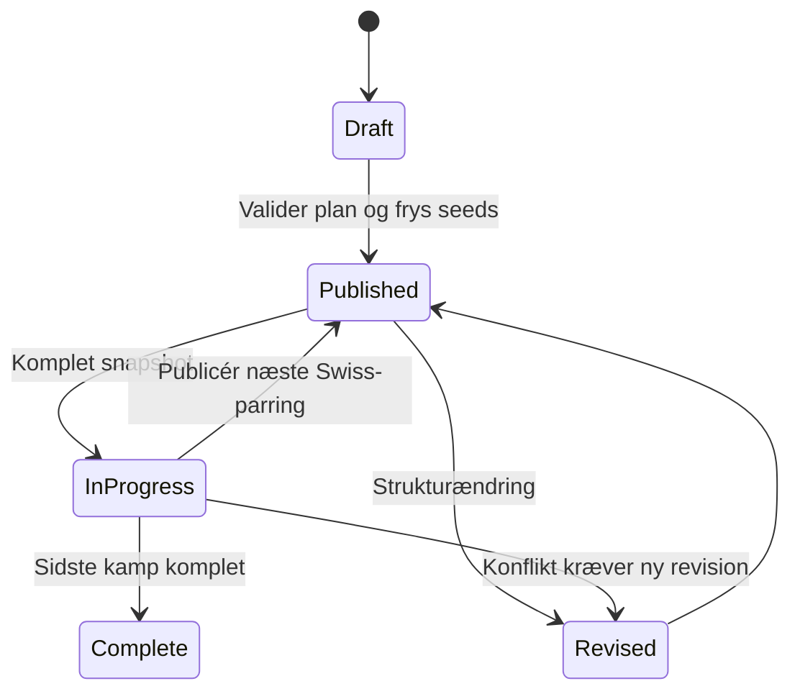

# Grupper og turneringer

Dashboardets hierarki er `Managerspil → Gruppe → Hold`. Et managerspil kan have almindelige gruppestillinger og turneringer side om side.

## Managerspil

Et managerspil identificeres af locale og slug og har et redigerbart navn. Det kan oprettes uden netværk. **Hent spilinfo** gemmer senere officielt navn, schedule, deadlines og autoritativ finalerunde, men overskriver ikke automatisk brugerens navn.

Rundecenter er managerspillets første fane. **Grupper** og **Statusalarmer** viser indholdstællere direkte i fanenavnet; de øvrige faner er Spillerstatistik, Holdstatistik, Historik, Analyse, Administration og Indstillinger. Managerspillets Historik sammenligner holdtrends og kan filtreres til en gruppe. Analyse er lazy-loadet via query-parameter og beregner kun det valgte panel. Arkivering flytter eller sletter ikke grupper, snapshots, manifester, metadata eller Hall of Fame-resultater. Rundecenterets statusordbog, links og fulde gruppematrix er beskrevet i [Rundecenter og daglig arbejdsgang](round-center.md).

## Almindelige grupper

En almindelig gruppe har fanerne **Stilling** og **Historik**. Historikken genbruger gruppens managerspil og medlemmer uden nye vælgere og viser værdi/point, rundevækst, samlet placering, rundeplacering og grupperang. Manglende runder eller placeringer forbliver huller, og alle rangakser vender førsteplads øverst.

Stillingen viser `Grupperang · Manager · Hold · Samlet placering · Rundeplacering · Værdi · Vækst · Afstand`:

- **Samlet** rangerer efter rundens sluttotal; afstand er forskellen til totallederen.
- **Runde** rangerer efter rundens ændring; afstand er forskellen til rundelederen.

Valget styrer grupperang, sortering og afstand. **Samlet placering** og **Rundeplacering** vises samtidig og er Holdet.dk's officielle placeringer blandt alle hold i managerspillet for den valgte runde. De beregnes ikke ud fra gruppen. Manglende officielle placeringer vises som **–**; en eksisterende grupperang kan stadig vises.

Competition ranking bruges ved ties i gruppen, og holdnavn er den deterministiske sekundære sortering. Officielle placeringer bevares som leveret af Holdet.dk. Se [Datahentning](data-retrieval.md#fantasyhold-historik-og-schedule) for datakilder og opdatering.

**Analyse → Gruppe** finder gruppeføreren fra den eksisterende stilling i valgt runde og viser fælles spillere, hver sides unikke spillere, afsluttet faktisk swing og en tydeligt mærket formbaseret proxy. Eksponering er antal ejere divideret med hold med dækkende rundesnapshot; UI viser altid dækkede hold, total gruppestørrelse og manglende hold. Der foretages ingen automatisk hentning af opstillinger.

## Turneringsformater

Schema-8-runtimeformatet er fortsat `TournamentConfig`; `TournamentDefinition` er det kompatible offentlige alias. `LeagueTemplateConfig`, `SwissTemplateConfig`, `GroupKnockoutTemplateConfig` og `DoubleEliminationTemplateConfig` er validerede projektioner via `tournament_template_config`. Guiden er opdelt i fire synlige trin: type/spil, navn/deltagere/regler, valideret preview og afsluttende oprettelse. Den bevarer indtastninger efter valideringsfejl og udfører ingen write før det sidste submit.

| Template | Plan |
| --- | --- |
| `league` | Circle schedule med én eller to indbyrdes kampe |
| `swiss` | Scoregrupper, Buchholz, rematch-undgåelse og fair bye |
| `group_knockout` | Serpentine-grupper, power-of-two-kvalifikation og krydsseedet bracket |
| `double_elimination` | Winners-/losers-bracket, to nederlag og eventuel reset-finale |

Fælles kamppoint er som standard 3/1/0. Stillingen kan derefter bruge `score difference`, `score for`, `head-to-head`, `Buchholz` og `entry seed`; stabilt hold-ID er et skjult sidste reservekriterium. Lige knockoutopgør afgøres af konfigurerede sportslige kriterier og til sidst højere seed.

Seedning kan være tilfældig, manuel eller Elo-baseret. Det konkrete seed-resultat og alle publicerede fixtures fryses på turneringsrevisionen. Senere Elo- eller datakorrektioner ændrer resultater, men aldrig allerede publicerede parringer.

Ligaen bruger circle scheduling og blokerer flere kampe til samme deltager i én fantasy-runde. Bibliotekets standard for Swiss er `ceil(log2(deltagere))` runder; næste parring må først publiceres efter eksplicit refresh af den foregående komplette runde. Parringssøgningen prøver først at finde en plan helt uden gentagelser. Kun når søgningen har gennemgået mulighederne uden at finde en sådan plan, tillades gentagne opgør. Rammer søgningen sin grænse, afbrydes publiceringen med en fejl; tilpas turneringen eller opret en ny revision. En Swiss-turnering kan først afsluttes, når alle konfigurerede runder er publiceret og komplette. Byen går deterministisk til den lavest rangerede deltager uden tidligere bye og tæller som en spillet sejr med turneringens konfigurerede sejrspoint, men først når runden er nået. Liga-byes giver ingen point.

Gruppespil + knockout understøtter 1–8 grupper, serpentine-seedning, gennemførlig kvalifikation og valgfri bronzekamp. Uden bronzekamp bestemmes bronze af den bedst rangerede tabende semifinalist. Double elimination understøtter op til 32 deltagere, byes og en reset-finale, når den ubesejrede finalist taber første finale.

### Revisioner og legacy

Ændring af format, deltagere, seedning, tie-breakers eller rundestruktur opretter en ny revision efter bekræftelse. Navn og officiel URL er kosmetiske og ændrer ikke revisionen. En datakorrektion må genberegne resultater, men en synlig pairing-konflikt kræver en ny revision.

Indlæste Swiss-parringer kontekstvalideres mod gruppe, revision, rundeinterval og deltagere. Dubletter, mere end én bye eller mere end én kamp pr. deltager og runde afvises. Efter datakorrektioner genberegnes den forventede parring som en ren kontrol; en afvigelse vises som konflikt, mens den publicerede parring forbliver uændret.

Parringslagerets schema 2 gemmer konkrete knockout- og double-elimination-kampe med stabilt kamp-ID, deltagere, seeds, runder og deres kilder i bracketen. Den samme revisions publicerede kampe kan ikke overskrives. Efter en korrektion beregnes scoringerne for de gemte deltagere igen; hvis nye resultater ville have givet andre deltagere eller seeds, vises en konflikt, og de berørte efterfølgende opgør og mesteren blokeres, indtil turneringen får en ny revision. Parringslagerets schema 1 for Swiss læses fortsat. Da ældre Swiss-data ikke angiver parringsalgoritmen, accepterer konfliktkontrollen for alle Swiss-runder både den tidligere og den nuværende algoritmes udfald; en korrektion kan derfor undgå at blive markeret, hvis dens nye parring svarer til den anden algoritmes udfald.

For en ældre knockoutturnering uden et parringslager etablerer en eksplicit opdatering først en baseline ud fra de eksisterende lokale snapshots, før nye data hentes. Der kan kun fastfryses kampe, hvis deltagere kan udledes af de snapshots; manglende historiske data kan ikke genskabe en tidligere vist parring. Selve visningen læser data og opretter ikke en baseline.

En ulæselig eller modstridende gemt kampplan vises som **Afventer gennemgang**. Den bruges ikke til officielle stillinger, mestre, indbyrdes sejre eller turneringsawards. Rå holddata bevares. Et historisk slutpunkt skjuler deltagere, hvis kvalifikation først kan afgøres senere, og aktive/eliminerede hold følger de bekræftede, ikke-blokerede opgør.

Gruppedefinitionens schema 1–7 læses som `group_knockout` med én gruppe, eksisterende fixtures og seeds, de tidligere tie-breakers og ingen bronzekamp. Kompatibilitetswrapperne `create_tournament_config` og `build_tournament_state` bevares.

Turneringens faner tilpasses templaten. Overblik, Kampe og Historik bevares; standings og brackets vises kun, når de er relevante.

## Managers og sæsoner

Den globale **Managers**-destination på `/managers` erstatter Hall of Fame som navigationsnavn. Den samler Elo, den eksisterende pointprofil, medaljer, rekorder, H2H, sæsoner og identitetsstyring. Den gamle `?view=hall-of-fame`-route viderestiller fortsat.

Managerens bedste hold pr. spil/runde tæller, og selvopgør fjernes. Komplette managerresultater publiceres som append-only eventrevisioner; navigation viser kun cachebaserede previews. Læs [Managers og sæsoner](managers-and-seasons.md) for identitet, Elo, awards, H2H og sæsonpoint.

## Kalender og officielle links

Kalenderen samler kommende gruppe- og turneringskampe fra lokal schedulemetadata og publicerede fixtures. Mangler tidspunktet, vises eventet separat med link til den eksisterende spilinfohandling. Navigationen henter eller skriver aldrig.

Grupper kan gemme en manuel `official_url` med typen `group` eller `minileague`. URL'en valideres som HTTPS på `www.holdet.dk` med korrekt locale-prefix, uden credentials. Hubben gætter ikke den konkrete grupperute.

## Opdatering

**Opdater managerspil** henter den seneste spillerliste én gang og deduplikerer hold på tværs af grupper. Spiller- og holdfejl rapporteres separat. **Opdater turnering** henter alle deltagere, også eliminerede og afsluttede, så rettelser kan genberegnes. Opdateringen etablerer først eventuelle legacy-baselines, henter data og publicerer derefter de runder, hvis forudgående runder er komplette, inden komplette events fryses for det aktuelle managerspil. Publicering af Swiss-runder er begrænset af turneringens konfigurerede sidste runde. Resultatet gemmes som snapshots og et uforanderligt manifest; delvise fejl bruger seneste gyldige cache, når den findes.

Se [Analyse- og beslutningscenter](decision-analysis.md) for swing-, eksponerings- og provenancekontrakter.
